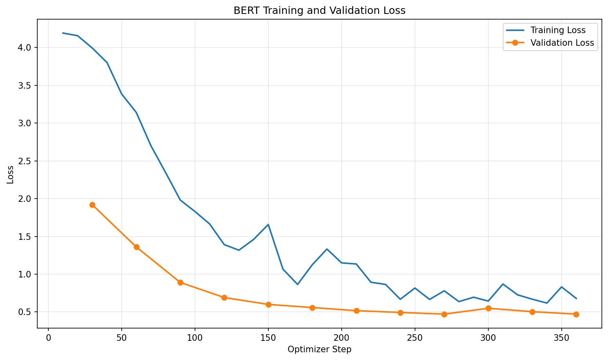
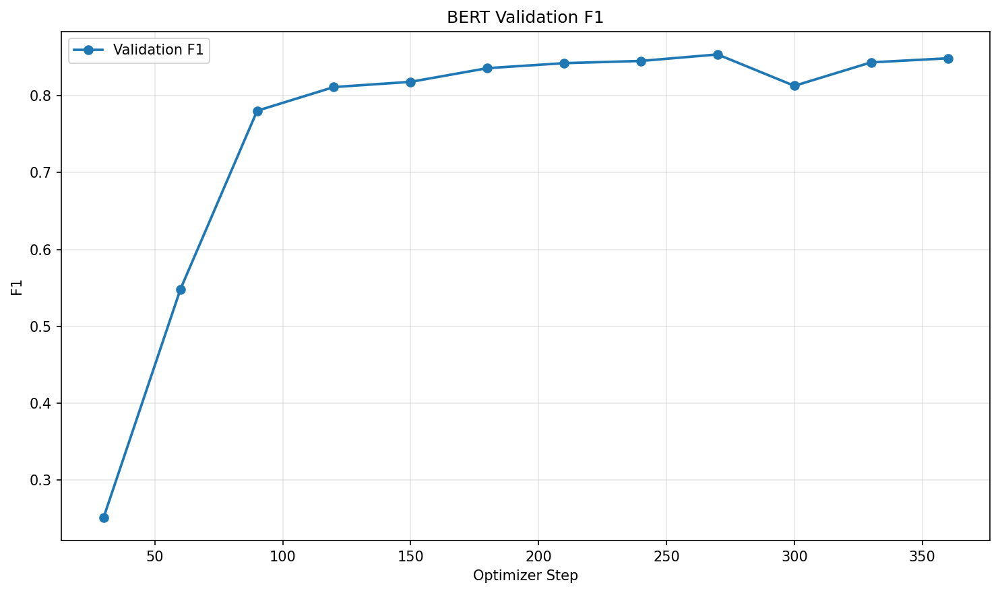

# 中文句子情緒分類

以老師提供的 BERT 二元分類程式為基礎，修改為中文情緒多元分類模型。

## 訓練資料來源

- 資料集：[Chinese_Multi-Emotion_Dialogue_Dataset](https://huggingface.co/datasets/Johnson8187/Chinese_Multi-Emotion_Dialogue_Dataset)
- 原始資料欄位：`text`（句子）、`emotion`（情緒）。
- 本次資料準備輸出共 4,159 筆。
- 訓練集：3,327 筆（約 80%）。
- 驗證集：832 筆（約 20%）。
- 使用 `stratify=labels` 維持類別比例，切分亂數種子為 42。

## 情緒標籤

依 CSV 的實際情緒名稱建立整數對照，並儲存於
`data/bert/label_mapping.json`。

| 編號 | 情緒     |
| ---- | -------- |
| 0    | 厭惡語調 |
| 1    | 平淡語氣 |
| 2    | 悲傷語調 |
| 3    | 憤怒語調 |
| 4    | 疑問語調 |
| 5    | 開心語調 |
| 6    | 關切語調 |
| 7    | 驚奇語調 |

## 基礎模型

[google-bert/bert-base-chinese](https://huggingface.co/google-bert/bert-base-chinese)

使用 `AutoModelForSequenceClassification` 建立 8 類分類模型，
並微調模型參數。

## 環境與套件

使用 Google Colab 的 CUDA GPU 環境，訓練時套件版本如下：

```text
torch==2.11.0+cu130
transformers==5.20.1
datasets==4.8.5
accelerate==1.15.0
scikit-learn==1.6.1
pandas==2.2.3
numpy==2.1.3
matplotlib==3.10.0
```

其中 PyTorch 使用 CUDA 13.0 建置版本。

<!-- 將上一個步驟印出的實際套件版本貼在這裡。 -->

## 程式功能

- `prepare_data.py`：讀取中文情緒資料，將情緒標籤轉為整數，並切分訓練集與驗證集。
- `train_bert.py`：微調 BERT 八類情緒分類模型，以驗證損失選出最佳模型，並計算正確率與 Macro F1。
- `infer_bert.py`：預測句子的情緒，輸出情緒名稱與小數點後四位的信心分數。
- `plot_bert_metrics.py`：讀取訓練紀錄，繪製 Loss 與 Macro F1 曲線。

## 訓練設定

<!-- 請對照 train_bert.py，確認下列值與實際訓練一致。 -->

| 設定                        | 數值                 |
| --------------------------- | -------------------- |
| Epochs 上限                 | 3                    |
| 訓練 batch size             | 8                    |
| 驗證 batch size             | 8                    |
| Gradient accumulation steps | 2                    |
| Learning rate               | 2e-5                 |
| 最大序列長度                | 512                  |
| 最佳模型選擇依據            | 最低 validation loss |

程式使用 Early Stopping，並於訓練結束後載回最佳模型再儲存。

## 執行方法

本次程式使用 Colab 路徑：

- 原始 CSV：`/content/data.csv`
- 作業資料夾：`/content/homework1`

若在其他環境執行，請先修改各程式中的輸入與輸出路徑。

安裝套件：

```bash
pip install -r requirements.txt
```

依序執行：

```bash
python /content/homework1/prepare_data.py
python /content/homework1/train_bert.py
python /content/homework1/infer_bert.py
python /content/homework1/plot_bert_metrics.py
```

若已下載本專案提供的微調模型，可直接執行推論，
不需要重新準備資料或訓練。

## 驗證結果

最佳 checkpoint：`checkpoint-270`。

| 指標                | 數值   |
| ------------------- | ------ |
| Validation loss     | 0.4716 |
| Validation accuracy | 待填   |
| Validation Macro F1 | 待填   |

驗證集用於模型選擇，以上數值不是獨立測試集的結果。

## 指定句子預測

<!-- 確認 infer_bert.py 的句子順序後，填入五句實際結果。 -->

<!-- 使用「句子 => 情緒 (四位小數分數)」格式。 -->

## 訓練曲線

### Loss



### Macro F1




## 模型限制

句子可能有多種語意，模型也可能誤判。
信心分數代表模型對預測類別的分數，不保證預測正確。

## 檔案說明

- `prepare_data.py`：資料準備。
- `train_bert.py`：模型訓練。
- `infer_bert.py`：句子情緒預測。
- `plot_bert_metrics.py`：訓練曲線繪製。
- `data/bert/label_mapping.json`：情緒標籤對照。
- `output/bert_emotion_clf/`：最佳模型與 Tokenizer。
- `images/`：README 使用的訓練曲線。
